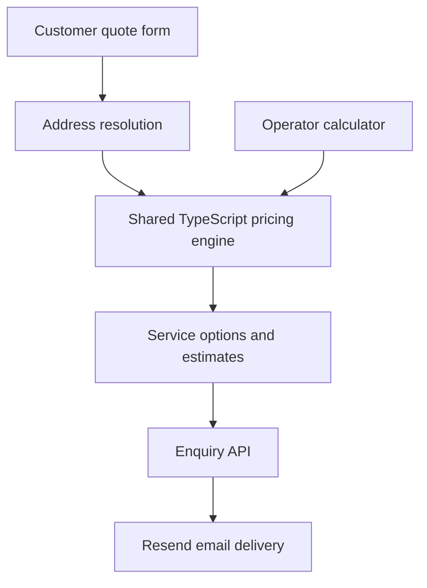

# Technical Showcase — Jack Cassidy

## Ardmore Vehicle Collection

**A deployed web application that turns a vehicle collection journey into a costed estimate and customer enquiry.**

[Visit the website](https://collect.ardmoreai.co.uk) · [Try the quote calculator](https://collect.ardmoreai.co.uk/quote)

This project brings together business process design, a TypeScript pricing model, a React customer interface and a server-side email integration. It supports a Belfast-based vehicle collection service, modelling journeys from Great Britain to Northern Ireland or the Republic of Ireland.

## The problem

A vehicle collection price depends on more than mileage. The driver needs to reach the seller, collect the car, drive to a suitable ferry, cross the Irish Sea, deliver the vehicle and get home. Notice periods affect travel costs, while the cheapest tickets can create an unnecessarily long working day.

The application turns those operational constraints into a repeatable pricing process. Customers see estimated totals and delivery options; the operator can inspect the underlying route choices and costs.

## What the application delivers

- **Customer quote flow:** collection and delivery locations, four service levels, estimated prices and arrival timing.
- **Route comparison:** airport and ferry combinations ranked using both cash costs and working time.
- **Personal quote fallback:** special arrangements and unsupported journeys become enquiries instead of unreliable automatic prices.
- **Email enquiries:** customer details, vehicle information and the selected estimate reach the business through a server-side API.
- **Separate operator view:** detailed costs, route alternatives, fee adjustments and effective hourly earnings.
- **Deployment:** Next.js application hosted on Vercel with a custom domain and configurable search indexing.

Submitting an enquiry does not take payment or confirm a booking. Final pricing and availability are checked before commitment.

## Technical stack

| Layer | Technology and purpose |
|---|---|
| Application framework | Next.js 15 App Router for pages, metadata and API routes |
| Interface | React 19, TypeScript and Tailwind CSS 4 |
| Pricing engine | Pure TypeScript functions with typed inputs and cost ranges |
| Location resolution | postcodes.io plus a local town gazetteer and NI postcode district fallback |
| Email | Resend, called from a Node.js route handler |
| Hosting | Vercel and a custom domain |
| Verification | TypeScript checks and a standalone assertion suite run before the production build |

## Architecture

The pricing model is separate from the interface and network calls. That makes the calculations reusable across the customer and operator views, and allows them to be verified without running a browser.

The application uses no database: quote calculations run in the browser, while enquiry delivery runs on the server. The Resend credential stays in the server environment.

## Engineering decisions

### 1. Model the whole journey

The engine considers the six nearest eligible arrival airports against the configured ferry routes. It includes applicable transfers, flights, fuel, crossings, cabins, insurance allowances, food, accommodation and the driver's return journey.

Costs are represented as low/high ranges. This reflects the uncertainty in travel prices while still producing a usable rounded estimate.

### 2. Optimise for time as well as money

Ranking routes only by ticket price can recommend a large driving detour to save a small amount. The model therefore uses:

**Route score = estimated cash cost + payable hours × hourly time value**

Overnight crossing time is discounted to reflect the opportunity to rest, with different assumptions for cabin and non-cabin travel. This makes the route choice sensitive to the practical working day.

### 3. Reprice each service tier

Flexible, Standard, Express and Emergency options use different lead-time assumptions for flights and ferries, as well as different service fees. The faster options therefore reflect both travel costs and the urgency of the work.

Customer arrival estimates also distinguish collection timing from the time needed to complete delivery.

### 4. Handle uncertain addresses explicitly

The customer flow recognises supported towns and UK postcodes. When someone pastes a full UK address, only the extracted postcode is passed to the postcode lookup service.

Ambiguous locations, unsupported journey directions and special collection requirements fall back to a personal quote. The interface avoids presenting an automatic estimate when the model cannot confidently describe the journey.

### 5. Keep email integration on the server

The enquiry endpoint validates required fields, limits input lengths and escapes values used in HTML email. It uses a content-derived idempotency key when calling Resend to reduce duplicate delivery of identical enquiries.

The customer receives success or failure feedback, and the business can reply directly using the customer's reply-to address.

### 6. Check the model and its documentation together

The verification suite covers:

- Fuel conversions and cost arithmetic.
- Distance estimates and route selection.
- Lead-time effects on pricing.
- Overnight cabin and rest assumptions.
- Offline NI postcode resolution.
- Supported and ambiguous customer addresses.
- Consistency between pricing data, reference figures and maintenance documentation.

The production build runs this verification before `next build`. TypeScript checking provides an additional check on the application code.

## Skills demonstrated

| Capability | Evidence in this project |
|---|---|
| Translating business requirements into software | Operational collection steps represented as costs, timing rules and service tiers |
| Full-stack application development | Customer interface, shared pricing logic and server-side enquiry endpoint |
| TypeScript modelling | Typed journeys, route options, cost bands and tier outputs |
| API integration | Postcode lookup and transactional email delivery |
| Product judgement | Simple customer estimates alongside a more detailed operator interface |
| Reliability | Offline location fallbacks, explicit enquiry errors and automated model verification |
| Deployment configuration | Vercel hosting, custom domain, environment variables and indexing controls |
| Technical documentation | Architecture, pricing assumptions, setup instructions and a rate-refresh process |

## Current scope and trade-offs

This is a working quoting and enquiry application. It uses researched flight and ferry price bands rather than live booking data, and estimates road distances from geographic coordinates rather than a road-routing API. Those choices keep the model simple and maintainable, but estimates need confirmation.

The internal calculator is marked `noindex`, which is not access control. Authentication would be an appropriate improvement before placing sensitive operational information there.

There is no payment processing, customer account system or automated booking workflow. Potential next steps include live route-distance data, authenticated operator access and persistent enquiry tracking.

---

**Project owner:** [Jack Cassidy](https://github.com/jcassidyGH)  
**Website:** [Ardmore Vehicle Collection](https://collect.ardmoreai.co.uk)

This repository contains the public technical case study. The application source is maintained separately in a private repository.
